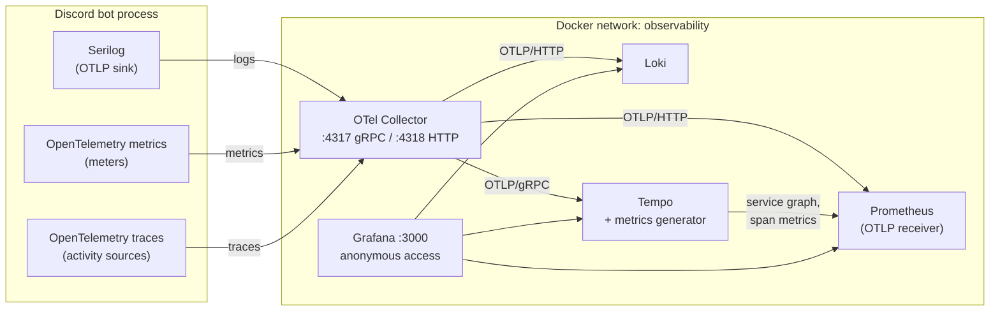

# Grafana Observability Stack

**Last Updated:** 2026-10-11

The bot ships logs, traces and metrics over OTLP to a self-hosted Grafana stack: an OpenTelemetry
Collector in front of Loki (logs), Tempo (traces) and Prometheus (metrics), with Grafana on top.
The stack lives in [`deployment/observability/`](../../deployment/observability/README.md) and
comes with seven provisioned dashboards and a set of Prometheus alert rules.

This page covers how the pieces fit together, how to configure the app, and every metric the app
emits. The older Prometheus-scrape guide ([Metrics](metrics.md)) and the Elastic guides still apply;
the `/metrics` scrape endpoint and the Elastic sinks are unchanged.

## Architecture

- **One resource for all signals.** Logs, traces and metrics carry the same `service.name`,
  `service.version`, `service.instance.id` and `deployment.environment`. Prometheus promotes
  `service.name`, `service.instance.id` and `deployment.environment` to labels; Loki indexes them
  as stream labels. Every dashboard filters on `$env` and `$instance` through these labels.
- **Correlation.** Each log line written inside a span carries `trace_id` and `span_id` as Loki
  structured metadata. Grafana links a log line to its trace, a span back to its logs (Tempo
  "Logs for this span"), and a span to its RED metrics. Exemplars are stored in Prometheus.
- **Push, not scrape.** The bot pushes metrics every 15 seconds
  (`OpenTelemetry:Otlp:MetricExportIntervalSeconds`). The `/metrics` scrape endpoint still exists.
- **Sampling** applies to traces only (`OpenTelemetry:Tracing:Sampling`, 10% by default in
  Production, with errors and slow spans always kept). Metrics and logs are never sampled, so
  dashboards built on metrics are exact; Tempo's span metrics see only sampled spans.

## Configuration

| Setting | Default | Purpose |
|---|---|---|
| `OpenTelemetry:Otlp:Endpoint` | `null` | Collector URL, e.g. `http://otel-collector:4317`. Falls back to `OTEL_EXPORTER_OTLP_ENDPOINT`. Empty on both: nothing is exported over OTLP. |
| `OpenTelemetry:Otlp:Protocol` | `grpc` | `grpc` or `http` (HTTP/protobuf, port 4318). For HTTP the `/v1/logs` etc. paths are added for you. |
| `OpenTelemetry:Otlp:Headers` | `null` | `key=value,key2=value2`, for a collector or vendor endpoint behind auth. |
| `OpenTelemetry:Otlp:ExportLogs` / `ExportMetrics` / `ExportTraces` | `true` | Turn a signal off without touching the others. |
| `OpenTelemetry:Otlp:MetricExportIntervalSeconds` | `15` | Metric push interval. |
| `OpenTelemetry:Tracing:OtlpEndpoint` | `null` | Older traces-only setting. Used for traces when `Otlp:Endpoint` is empty. |
| `OpenTelemetry:ServiceName` | `discordbot` | `service.name` on every signal. |
| `Observability:GrafanaUrl` | `null` | Shows a Grafana link in the portal sidebar (Developer section, Admin+). |

The Docker Compose files set `OpenTelemetry__Otlp__Endpoint` from `OTLP_ENDPOINT` (default
`http://otel-collector:4317`) and attach the bot to the external `observability` network. Set
`OTLP_ENDPOINT=` (empty) in `.env` to turn export off.

Running the bot on the host instead: the collector publishes 4317 and 4318, so use
`OpenTelemetry__Otlp__Endpoint=http://localhost:4317`.

## Dashboards

All seven live in the **Discord Bot** folder, linked to each other from the top-right menu, and
share the `Environment` and `Instance` variables. Two annotations are on by default: gateway
disconnects (red) and process restarts (purple).

| Dashboard | Answers |
|---|---|
| **Overview** (home) | Is it up (gateway, health checks, background services)? Is it serving (commands, HTTP)? What is failing (firing alerts, recent warnings and errors)? |
| **Gateway, Commands & Features** | Gateway availability and latency, disconnect reasons, Discord.NET log events, REST responses and rate limits by route, per-command volume / failure rate / p95, components, auto-mod, voice, audio playback, VOX, reminders, scheduled messages. |
| **Web Portal & API** | Inbound HTTP by route and status, unhandled exceptions, Kestrel and SignalR connections, outbound HTTP by host (OpenRouter, Azure, Discord OAuth). |
| **AI Assistant** | Requests and success rate by mode, spend by model and mode, tokens by type and cache hit ratio, completion latency and stop reasons, tool calls by outcome, slowest tools, assistant traces. |
| **Runtime & Data** | CPU, memory, GC, thread pool, exceptions; Npgsql pool and command latency, slow queries; cache hit ratio; work queues; background services table and health checks. |
| **Logs & Traces** | Log volume, noisiest sources, a searchable log view; failed and slow traces; the service map; span p95 by operation. |
| **Business & SLOs** | Service levels computed from raw counters (command success, gateway and HTTP availability, true p99) next to the app's own SLO gauges; growth and engagement. |

The dashboards are generated by `deployment/observability/grafana/generate_dashboards.py`. Edit the
script and re-run it rather than editing the JSON; Grafana picks up file changes within 30 seconds.

## Alerts

`deployment/observability/prometheus/alerts.yml` defines 17 rules in four groups: availability
(no metrics, gateway down or flapping, high latency, unhealthy health check), errors (command
failure rate, HTTP 5xx rate, Discord 429s, background service errors, queue backlog), assistant
(failure rate, hourly spend, dropped usage rows) and resources (CPU, thread-pool starvation, Npgsql
pool exhaustion). They show on the Overview dashboard and under Grafana's Alerting page. There is
no Alertmanager in the stack, so nothing is sent anywhere until one is added.

## Metric reference

OTLP instrument names translate to Prometheus names: dots become underscores, counters gain
`_total`, and the unit is appended (`ms` becomes `_milliseconds`, `s` becomes `_seconds`, `By`
becomes `_bytes`, `%` becomes `_percent`; units in braces such as `{commands}` are dropped). For
example `discordbot.command.duration` is queried as `discordbot_command_duration_milliseconds_bucket`.

### Added with the Grafana stack

| Meter | Instrument | Type | Tags | Recorded by |
|---|---|---|---|---|
| `DiscordBot.Discord` | `discordbot.gateway.connected` | gauge | | `DiscordGatewayMetricsService` (socket client events) |
| | `discordbot.gateway.latency` (ms) | gauge | | heartbeat `LatencyUpdated` |
| | `discordbot.gateway.connection.events` | counter | `event`, `reason` | `Connected` / `Disconnected` |
| | `discordbot.gateway.events` | counter | `event` | message, interaction, member, voice and guild events |
| | `discordbot.discord.log.events` | counter | `severity`, `source` | Discord.NET `Log` |
| | `discordbot.discord.rest.responses` | counter | `route` | `DiscordSocketConfig.DefaultRatelimitCallback` |
| | `discordbot.discord.rest.ratelimits` | counter | `route`, `kind` (hit, exhausted), `scope` | same |
| `DiscordBot.Llm` | `discordbot.llm.request.count` | counter | `mode`, `model`, `status` | `LlmUsageRecorder.Record` (one per assistant request) |
| | `discordbot.llm.request.duration` (ms) | histogram | same | same |
| | `discordbot.llm.tokens` | counter | `mode`, `model`, `type` | same |
| | `discordbot.llm.cost.usd` | counter | `mode`, `model` | same |
| | `discordbot.llm.completions`, `discordbot.llm.tool_calls` | counter | `mode`, `model` | same |
| | `discordbot.llm.usage_queue.depth` | gauge | | usage ledger queue |
| | `discordbot.llm.usage_records.dropped` | counter | | usage ledger queue overflow |
| `DiscordBot.Agents` | `discordbot.agent.completion.count`, `.duration` (ms) | counter, histogram | `model`, `status`, `stop_reason` | `AgentRunner` (every model call) |
| | `discordbot.agent.tool.count`, `.duration` (ms) | counter, histogram | `tool`, `outcome` | `AgentRunner` (every tool call; invented names collapse to `unknown`) |
| `DiscordBot.BackgroundServices` | `discordbot.background.heartbeats` | counter | `service` | `MonitoredBackgroundService.UpdateHeartbeat` |
| | `discordbot.background.errors` | counter | `service`, `fatal` | `MonitoredBackgroundService.RecordError` and fatal exits |
| | `discordbot.background.up` | gauge | `service`, `status` | `IBackgroundServiceHealthRegistry` |
| | `discordbot.background.heartbeat.age` (s) | gauge | `service` | same |
| `DiscordBot.Health` | `discordbot.health.status` | gauge (1 / 0.5 / 0) | `check` (`database`, `discord`, `overall`) | `HealthCheckMetricsPublisher`, every 30 s |
| | `discordbot.health.check.duration` (ms) | gauge | `check` | same |
| `DiscordBot.Features` | `discordbot.automod.detections` | counter | `rule_type`, `severity` | `AutoModerationHandler` |
| | `discordbot.automod.actions` | counter | `action`, `status` | same |
| | `discordbot.reminders.deliveries` | counter | `status` | `ReminderExecutionService` |
| | `discordbot.scheduled_messages.executions` | counter | `status` | `ScheduledMessageExecutionService` |
| | `discordbot.audio.playbacks`, `.playback.duration` (s) | counter, histogram | `source` (soundboard, tts), `status` | `AudioStreamer`, `TtsPlaybackService` |
| `DiscordBot.State` | `discordbot.queue.depth` | gauge | `queue` (audit_log, member_sync) | queues |
| | `discordbot.interaction_state.active` | gauge | | `IInteractionStateService` |
| | `discordbot.voice.connections` | gauge | | `AudioService` |
| | `discordbot.cache.requests`, `discordbot.cache.entries` | counter, gauge | `prefix`, `result` | `IInstrumentedCache` |
| | `discordbot.db.queries`, `discordbot.db.slow_queries` | counter | | `IDatabaseMetricsCollector` |
| | `discordbot.process.cpu.usage` (%) | gauge | | `ICpuHistoryService` |
| | `discordbot.process.memory.working_set` (By), `discordbot.process.uptime` (s) | gauge | | process |
| | `discordbot.signalr.subscribers` | gauge | `group` | `IPerformanceSubscriptionTracker` |

Framework meters now exported as well: `Microsoft.AspNetCore.Hosting` / `.Server.Kestrel` /
`.Http.Connections` (SignalR) / `.Routing` / `.Diagnostics` / `.RateLimiting`, `System.Net.Http`,
`System.Net.NameResolution` and `Npgsql` (connection pool and command duration, with second-scale
buckets).

### Existing meters

`DiscordBot.Bot` (commands, components, rate-limit violations, guild and member gauges),
`DiscordBot.Api` (portal API middleware), `DiscordBot.Business`, `DiscordBot.SLO` and
`DiscordBot.Vox` are unchanged; see [Metrics](metrics.md). Two of the SLO gauges are proxies:
`discordbot.slo.command.p99_latency_1h` is the maximum, not a p99, and
`discordbot.slo.uptime.percentage_30d` is the 30-day command success rate. The Business & SLOs
dashboard shows the real figures computed from histograms and from `discordbot.gateway.connected`.

## Known gaps

- `discordbot.vox.concatenation.duration` and `discordbot.vox.audio.bytes` are defined but never
  recorded: the concatenation runs in Infrastructure, which cannot reach the Bot-layer `VoxMetrics`.
- `discordbot.users.unique` sums member counts across guilds, so a user in two guilds counts twice.
- `discordbot.business.feature.usage` is only recorded by VOX.
- Long-lived background-service root spans (`background.service.*`) stay open for the service's
  lifetime, so their child spans show in Tempo as "root span not yet received".
- The Elastic APM agent is enabled by default and, without an APM server, retries
  `http://localhost:8200` continuously. Those failures appear in the logs, the exception rate and
  the outbound-HTTP panels. Set `ElasticApm:Enabled=false` when you are not running Elastic APM.

## Related

- [`deployment/observability/README.md`](../../deployment/observability/README.md): running the stack
- [Debugging with Grafana (Agents)](grafana-agent-debugging.md): querying the stack over HTTP while testing a change
- [Metrics](metrics.md), [Distributed Tracing](tracing.md), [Log Aggregation](log-aggregation.md)
- [Configuration Guide](configuration-guide.md)
